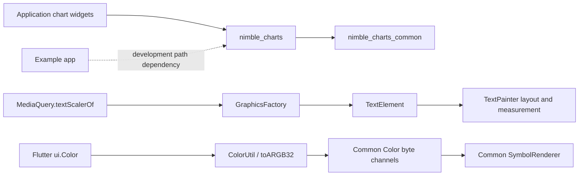

# Nimble Charts Architecture

## Scope

This repository contains the two packages consumed by MyMicroBalance:

- `charts_common` owns platform-independent chart models, layout, rendering
  contracts, selection state, and date/number formatting.
- `charts_flutter` adapts those contracts to Flutter widgets, painters,
  semantics, gestures, and themes.
- `charts_flutter/example` is the demo application and a development-only
  dependency of `charts_flutter`; its native hosts are maintained separately.

The public package names are `nimble_charts_common` and `nimble_charts`.
MyMicroBalance also imports `charts_flutter/lib/src/text_element.dart` and
`text_style.dart` directly, so those source paths and constructors are treated
as compatibility boundaries.

## Package and rendering flow

## Dependency boundaries

- `charts_common` must resolve and test independently with Dart from the pinned
  Flutter SDK.
- `charts_flutter` declares `charts_common` through the repository Git URL,
  branch, and `charts_common` path. A package-local `pubspec_overrides.yaml`
  may point to `../charts_common` only while developing unpublished commits;
  overrides are never committed.
- The example keeps its path dependency on `charts_flutter` so library tests
  can compile the existing example-widget closure without requiring a native
  Gallery build.
- Package lockfiles are generated independently and verified offline with
  `--enforce-lockfile`.

## Compatibility invariants

- A `TextScaler` travels from `MediaQuery` to `TextPainter` unchanged; it must
  not be reduced to one global scale factor.
- `TextElement.textScaleFactor` remains a linear compatibility adapter. When a
  modern scaler and the legacy factor are both supplied, the modern scaler
  wins.
- Flutter colors become Common colors through rounded ARGB32 byte extraction;
  Common channels are never normalized doubles.
- Hidden legend text and symbols preserve 0.26 alpha semantics.
- Chart selection continues to return the original datum and its measure.

## Validation

- `charts_flutter/test/upgrade/flutter_3449_charts_test.dart` covers the SDK
  migration boundaries with real Flutter painters and widgets.
- `charts_common/test/chart/cartesian/axis/time/simple_time_tick_formatter_test.dart`
  protects English and German date labels around a month boundary.
- `charts_flutter/test/widget_tests/chart_interactions_test.dart` retains the
  established tap-selection and golden checks.
- Analyze `lib` and `test` in both packages. New lint families from the current
  lint bundle remain warnings until the dedicated mechanical cleanup; compiler
  errors and external deprecated API uses are not accepted.
