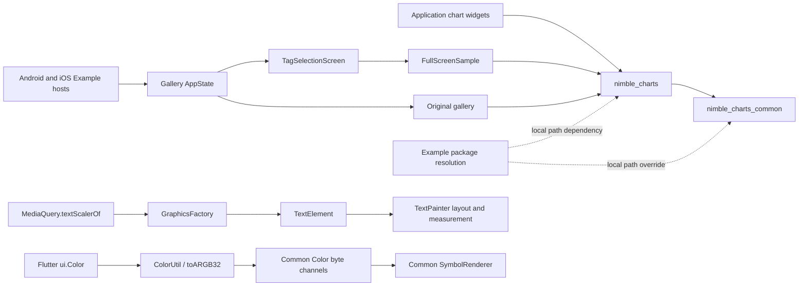

# Nimble Charts Architecture

## Scope

This repository contains the two packages consumed by MyMicroBalance:

- `charts_common` owns platform-independent chart models, layout, rendering
  contracts, selection state, and date/number formatting.
- `charts_flutter` adapts those contracts to Flutter widgets, painters,
  semantics, gestures, and themes.
- `charts_flutter/example` is the executable Gallery application, owns the
  modern tag picker and the original deterministic gallery, and maintains its
  Android/iOS development hosts independently from consumer applications.

The public package names are `nimble_charts_common` and `nimble_charts`.
MyMicroBalance also imports `charts_flutter/lib/src/text_element.dart` and
`text_style.dart` directly, so those source paths and constructors are treated
as compatibility boundaries.

## Package and rendering flow

## Dependency boundaries

- `charts_common` must resolve and test independently with Dart from the pinned
  Flutter SDK.
- `charts_flutter` declares `charts_common` through the repository Git URL,
  branch, and `charts_common` path. A package-local `pubspec_overrides.yaml`
  may point to `../charts_common` only while developing unpublished commits;
  overrides are never committed.
- The Flutter package's cleanup regression accepts Common only from that
  canonical local sibling or from the expected repository's Pub Git cache.
  A cached source must expose the same `HEAD:charts_common` tree as this
  checkout, so a stale resolved ref cannot make library tests pass.
- The example keeps its path dependency on `charts_flutter` and a scoped
  `nimble_charts_common` path override. Its generated package configuration
  must therefore resolve both packages to this checkout, never to a hosted or
  Git-cache copy. This is an Example-only development boundary and does not
  activate application-level overrides.
- Package lockfiles are generated independently and verified offline with
  `--enforce-lockfile`.

## Native host invariants

- Android keeps Flutter's plugin DSL and SDK/NDK defaults while pinning AGP
  8.10.1, Gradle 8.11.1, Kotlin 2.1.21, Java/Kotlin 17, and target SDK 36.
  The namespace and application ID remain `com.example.example`.
- iOS uses `FlutterImplicitEngineDelegate` for plugin registration and one
  `FlutterSceneDelegate`/`Main` application scene. Multiple scenes are off,
  and every Runner build configuration targets iOS 15.
- The Gallery has no native plugin dependency, so its iOS host does not add a
  Podfile or another package manager merely to build the Example.

## Compatibility invariants

- A `TextScaler` travels from `MediaQuery` to `TextPainter` unchanged; it must
  not be reduced to one global scale factor.
- `TextElement.textScaleFactor` remains a linear compatibility adapter. When a
  modern scaler and the legacy factor are both supplied, the modern scaler
  wins.
- Flutter colors become Common colors through rounded ARGB32 byte extraction;
  Common channels are never normalized doubles.
- Hidden legend text and symbols preserve 0.26 alpha semantics.
- Chart selection continues to return the original datum and its measure.

## Validation

- `charts_flutter/test/upgrade/flutter_3449_charts_test.dart` covers the SDK
  migration boundaries with real Flutter painters and widgets.
- `charts_common/test/chart/cartesian/axis/time/simple_time_tick_formatter_test.dart`
  protects English and German date labels around a month boundary.
- `charts_flutter/test/widget_tests/chart_interactions_test.dart` retains the
  established tap-selection and golden checks.
- `charts_flutter/example/test/upgrade/flutter_3449_example_test.dart` covers
  local package roots, native pins, modern phone/tablet filtering, navigation,
  theme changes, and representative deterministic original samples.
- `charts_flutter/example/test/upgrade/native_build_test.dart` builds the real
  Example hosts from the Example working directory, then checks the API-36
  debug APK with `aapt` and the single-scene iOS-15 Simulator bundle with
  `plutil`.
- The existing formatter, localization, painter, selection, golden, and
  Gallery regressions are additionally selectable through
  `MMB0014_source_cleanup_regression`; their original names remain stable.
- Mechanical formatting covers the authored `lib` and `test` paths per
  package. Generated `charts_common/test/mox.mocks.dart`, native/generated
  files, and golden images remain outside that write scope.
- Analyze `lib` and `test` in both packages. New lint families from the current
  lint bundle remain warnings until the dedicated mechanical cleanup; compiler
  errors and external deprecated API uses are not accepted.
